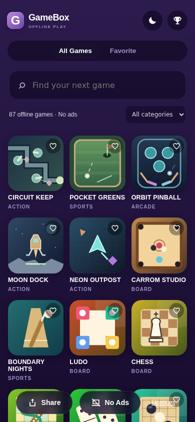
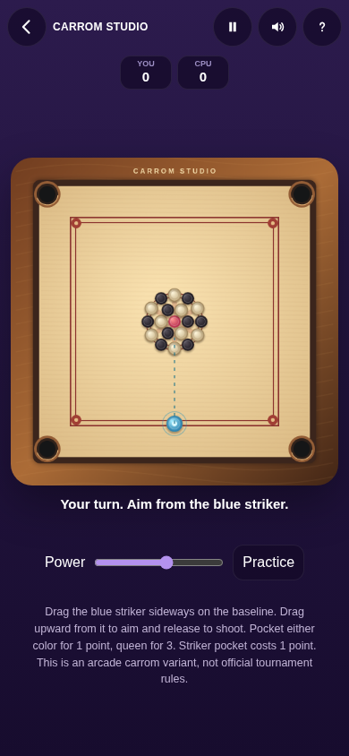
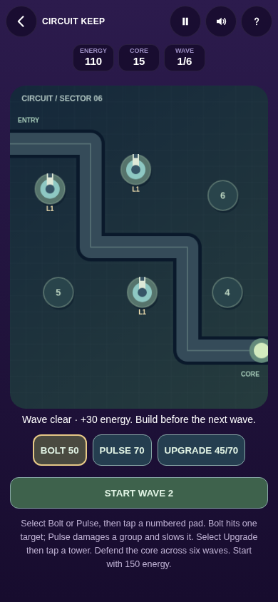
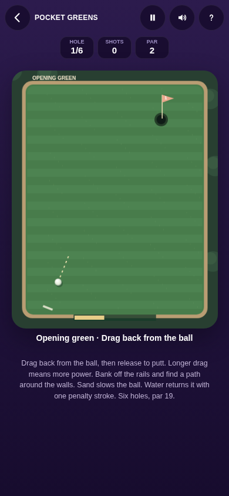
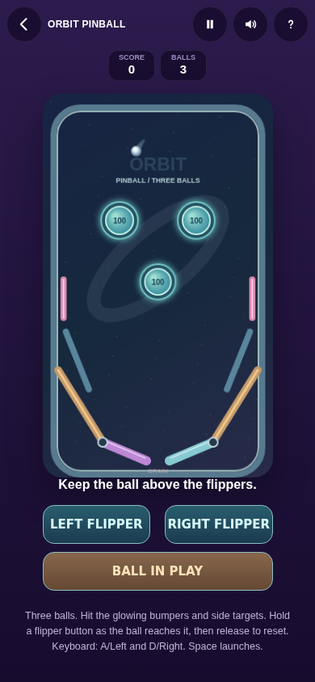

# GameBox - Offline Games App

[Download v0.5.0 APK](https://github.com/AKASH991833/gamebox-offline-games-app/raw/refs/heads/main/1-gamebox-v0.5.0.apk) | [Full source and tests](2-gamebox-v0.5.0-source.zip) | [Previous v0.4 APK](1-gamebox-v0.4.0.apk)

87 offline games for Android 7.0 and newer. English interface, no accounts, no ads, no payment and no declared Android permissions.

## v0.5.0 candidate - 25 October 2026

This is a signed quality-batch candidate, not a claim of completed device testing. It retains all 80 games from v0.4 and adds seven original games:

- Carrom Studio: wood board, coin physics, practice or computer turns. Arcade rules, not tournament carrom.
- Boundary Nights: a six-ball batting timing challenge, not a full cricket simulator.
- Neon Outpost: five-wave movement-survival arena, auto-fire, dash and repair pickups.
- Moon Dock: three landing sites, fuel and safe-speed/angle telemetry.
- Orbit Pinball: three-ball arcade table, bumpers, targets and held flippers. Arcade impulse physics.
- Pocket Greens: six mini golf holes with bank shots, walls, sand and water penalties.
- Circuit Keep: six-wave tower defense, two tower types, upgrades and energy economy.

Eight existing games and the shared interface have graphics updates: Road Rush, Dash Runner, Galaxy Guard, Brick Breaker, Bubble Pop, Crossy Dash, Flappy Dot, Tower Stack and the shared catalog/interface. The interface is not counted as another game.

Control and logic fixes include swipe/tap separation, pause and canceled input, readable dialogs, keyboard catalog navigation, short-screen layout, Snake tail/full-board behavior, Maze Run cell-center movement, Brick Breaker reflection and 2048 restart/undo animation isolation.

## Verification and limits

- APK package `com.akash.gamebox`, version code 5, version 0.5.0. Minimum SDK 24, target SDK 33.
- APK signature verified. Certificate SHA-256 matches the previous release: `90e31baeca81d48549cb2e9793dd52a1f0effb7e61d08c5502af96597b978fec`.
- All 614 app asset files matched the checked source byte for byte.
- 87 browser game-page launches passed with external requests blocked and the canvas roundRect API removed to test the fallback. All 87 also launched via file:// in desktop Chromium.
- Twelve reusable browser suites and four core simulation suites passed. See TESTING.md for the exact scope, fixtures and automated-controller qualifications.
- Actual Android installation, upgrade, saved-data survival, touch usability and low-end-device performance remain untested. Matching the signing certificate does not prove those outcomes. Do not uninstall the old app to try an update.
- No guarantee about winning difficulty or physical-device frame rate is made. Controller wins and injected end-state fixtures are not human-play wins.

## Build and test

Use JDK 11, Android SDK 33 and Gradle 7.6.4 with the supplied Gradle project. Release signing requires your existing keystore, which is intentionally not in this source archive. Never generate a replacement signing key for an update.

Run `cd tests && npm run core` for the Node-only simulation suites. For browser suites, install the pinned Playwright dependency and Chromium, have Python 3 available, then run `npm run browser`. Run browser tests serially; they serve the app on localhost:8766.

The original 24 games and the following 56 licensed classics are retained. The sections below describe that earlier addition, not 56 further additions in v0.5.

## Added games

### Board

Ludo, Chess, Snakes and Ladders, Dominoes, Checkers, Reversi, Backgammon, Mancala, Tigers and Goats, Nine Men's Morris, Go, Five in a Row, Hex, Dots and Boxes, Chinese Checkers, Royal Game of Ur, Fleet Battle, Fanorona, Halma, Viking Tafl, Konane, Surakarta, Tablut, Seega, Alquerque, Fox and Geese.

### Cards

Klondike Solitaire, Spider Solitaire, FreeCell, Pyramid Solitaire, Crazy Eights, Old Maid, Card War.

### Puzzle

Nonogram, Mahjong Solitaire, Kakuro, Calcudoku, Futoshiki, Peg Solitaire, Crate Pusher, Bridges, Loop Puzzle, Skyscrapers, Tangram, Link Pairs, Bulls and Cows, Pentomino, Math Cross, Matchstick Puzzles, No Neighbors, Number Pairs, Arrow Paths, Ring Puzzle, Shape Sort, Shadow Match, Odd One Out.

## Existing 24 games retained

2048, Snake Rush, Tic Tac Toe, Memory Match, Mine Sweeper, Brick Breaker, Flappy Dot, Sudoku, Tower Stack, Mole Smash, Beat Echo, Paddle Clash, Block Drop, Galaxy Guard, Dash Runner, Road Rush, Crossy Dash, Bubble Pop, Target Tap, Maze Run, Connect Four, Slide 15, Lights Out and Word Guess.

## Earlier v0.4 verification (historical)

- All 56 added games passed a desktop Chromium loading/basic-interaction smoke test with external network requests blocked: no JavaScript errors, missing assets or horizontal overflow at 390px.
- All 56 rules pages passed loading/layout checks at 360px. These are not exhaustive rules proofs.
- All original 24 game pages loaded without JavaScript errors or horizontal overflow at 360px.
- Search, categories, favorites across reload, and catalog/game/Home navigation checked.
- Real Klondike stock draw and Ace-to-foundation move checked, including two-digit card rendering. Ludo roll and selected core movement rules checked.
- Chess initial position has 20 legal moves; Fool's Mate is recognized as Black checkmate.
- Upstream randomized core tests passed for Dominoes, Old Maid, War, Snakes and Ladders, Math Cross, Matchstick Puzzles, Number Pairs, Shape Sort, Shadow Match, Link Pairs, Odd One Out, Ring Puzzle and Pentomino. Arrow Paths exhaustive run exceeded the time bound; its basic interaction smoke test passed, but exhaustive testing remains incomplete.
- Four representative games launched under file://. Desktop 4x CPU throttling checked representative startup only. Android installation, touch behavior, long play sessions, memory use, battery use and low-end-device performance remain unverified.

The v0.4 batch focused on 2D classics. This v0.5 candidate adds the original action and sports games described above, but still does not complete every screenshot reference or the longer-term worldwide catalog ambition. No proprietary game code or commercial artwork was copied.

## Source and licences

The original 24 games are retained from GameBox v0.3.0. The 56 added games adapt PaperGames v253, checked out at MIT-licensed revision `ce68675` (before its later licence change): https://github.com/YourChaosChris/PaperGames

See `app/src/main/assets/www/classics/LICENSE.txt`, `NOTICE.txt` and `credits.html` (including the complete BSD-3-Clause chess-artwork text). The cburnett chess artwork uses its BSD licence option. The upstream notices are retained; some refer to upstream games/assets not shipped in this selected collection. New GameBox wrapper styling, colored board treatments, pawn artwork and mechanic covers accompany those rules engines. Do not assume the current upstream licence is the same as this historical revision.

## Build

Native Android Activity and hardware-accelerated WebView, vanilla HTML/CSS/JavaScript. Android Gradle Plugin 7.4.2, Gradle 7.6.4, JDK 11, compile/target SDK 33, min SDK 24.

1. Install JDK 11, Gradle 7.6.4 and Android SDK 33/build-tools 33.0.2.
2. Set `ANDROID_HOME` or create a local `local.properties` pointing to the SDK.
3. Run `gradle assembleDebug` for a local debug build.
4. For release signing, supply the existing `gamebox.keystore` with alias `gamebox` and set `GB_STORE_PASSWORD` and `GB_KEY_PASSWORD`, then run `gradle assembleRelease`. The production key and passwords are intentionally not in this source archive. A different signing key cannot update an existing production installation.

Screenshots are browser captures at phone-sized viewports, not Android-device captures.
