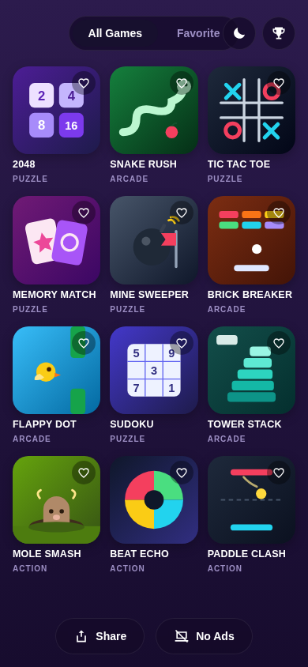
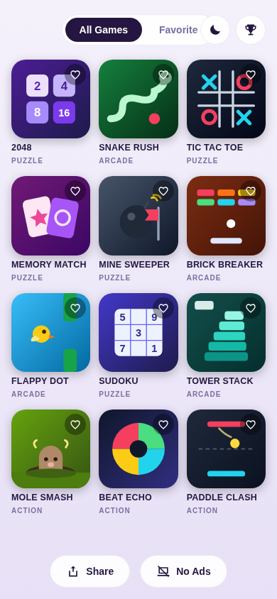
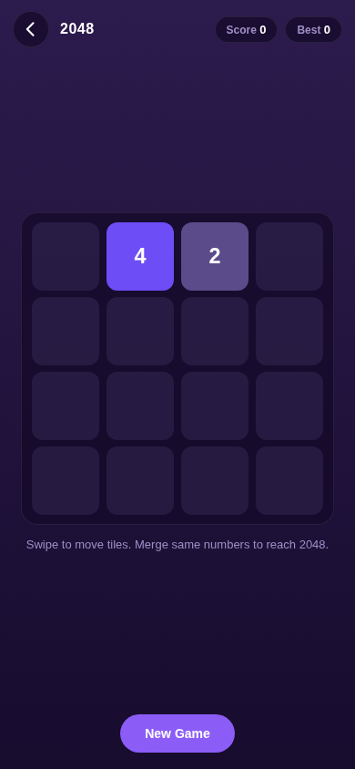
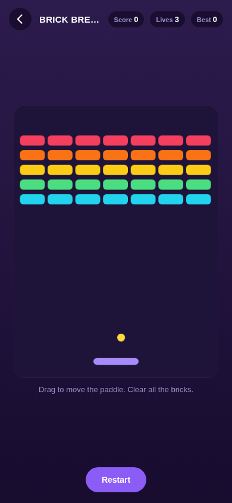
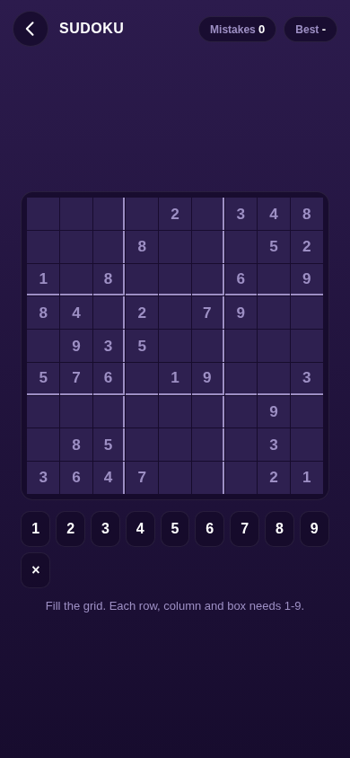

# GameBox - Offline Games App

24 classic mini-games in one tiny, fully offline Android app. No internet permission, no ads, no accounts - install and play anywhere.

**Download APK (v0.3.0):** https://drive.google.com/file/d/1JcyQ1lEvtIzlWr7wt5g5O0zq5dcf6xYi/view (APK is ~0.1 MB. Google Drive shows a standard "Download anyway" prompt for APK files.)

**Source code:** [gamebox-v0.3.0-source.zip](gamebox-v0.3.0-source.zip)

## What's new in v0.3.0 (25 Oct 2026)

- **12 new games** (12 -> 24 total): Block Drop, Galaxy Guard, Dash Runner, Road Rush, Crossy Dash, Bubble Pop, Target Tap, Maze Run, Connect Four, Slide 15, Lights Out, Word Guess.
- New games share the same shell as the originals: Home/back navigation, pause (action games), sound toggle, how-to-play rules, per-game best scores, dark/light themes, delta-time loops with devicePixelRatio-crisp canvas.
- Connect Four ships with Easy/Normal/Hard AI (alpha-beta minimax) plus a 2-player mode; Word Guess, Slide 15 and Lights Out track best streaks / fewest moves.
- Installs as an update over v0.2.0 (same signing key); best scores and favorites carry over.

### v0.2.0 (24 Oct 2026)

- Proper navigation, pause/resume/restart, rules, delta-time game loops, small-screen layouts, Memory Match icons fixed.

## Games

**Puzzle:** 2048, Sudoku, Tic Tac Toe, Memory Match, Mine Sweeper, Block Drop, Maze Run, Connect Four, Slide 15, Lights Out, Word Guess
**Arcade:** Snake Rush, Brick Breaker, Flappy Dot, Tower Stack, Galaxy Guard, Dash Runner, Road Rush, Crossy Dash, Bubble Pop
**Action:** Mole Smash, Beat Echo, Paddle Clash, Target Tap

All game code and cover art are original, written for this project.

## Features

- 100% offline: the app has no INTERNET permission at all
- Dark and light themes
- Favorite games list
- Best-score tracking per game (stored on-device)
- Share the app via the native Android share sheet
- English UI

## Screenshots

| Home (dark) | Home (light) | 2048 | Brick Breaker | Sudoku |
|---|---|---|---|---|
|  |  |  |  |  |

## Tech

Native Android (minSdk 24 / Android 7.0+) shell hosting a hardware-accelerated WebView. Games are vanilla HTML/CSS/JS in `app/src/main/assets/www` - no frameworks, no bundler.

Build: `gradle assembleRelease` (AGP 7.4.2, Gradle 7.6.4). Signed with the same key since v0.1.0, so updates install over earlier versions and Android keeps local data (best scores, favorites, theme).
