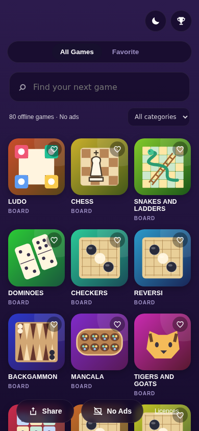
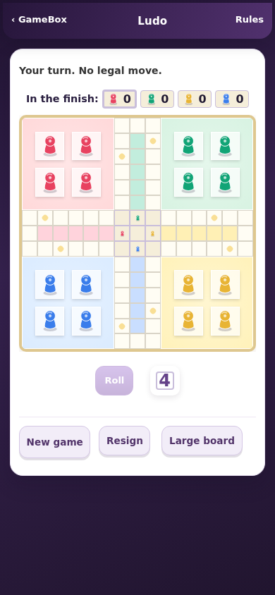
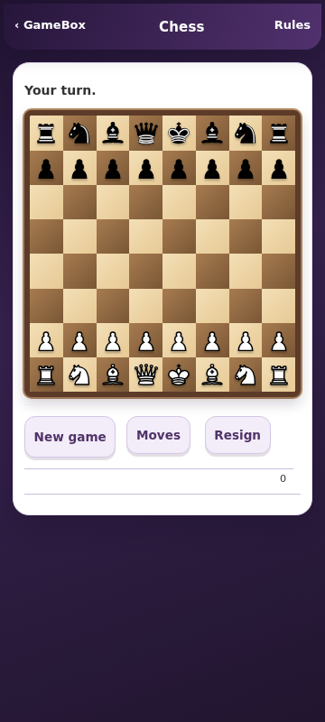
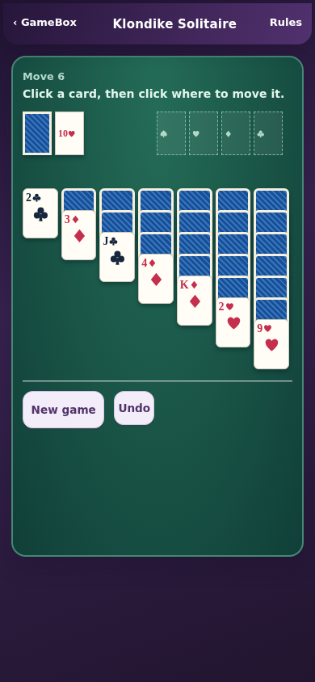
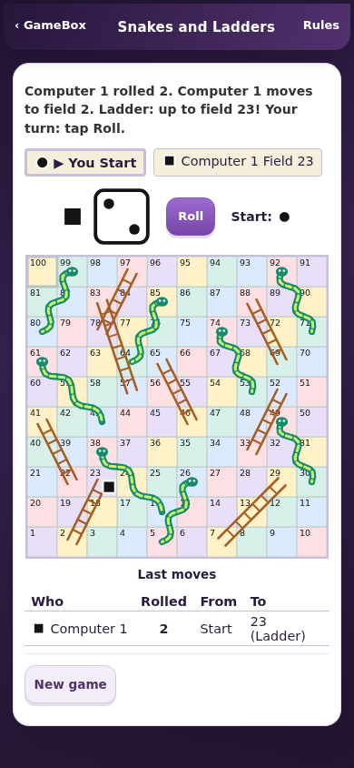

# GameBox - Offline Games App

80 offline games for Android 7.0 and newer: the existing 24 mini-games plus 56 new board, card and puzzle games. English interface, no accounts, no ads, no payment and no Android permissions.

[Download v0.4.0 APK](1-gamebox-v0.4.0.apk) (1.41 MB) | [Complete source ZIP](2-gamebox-v0.4.0-source.zip). This is a test build with the device-testing limits below.

## v0.4.0 - 25 October 2026

- Searchable catalog with categories, favorites and illustrated game covers.
- Ludo with colored pawns, wooden chess board, colored Snakes and Ladders, and felt-table solitaire cards.
- Local rules pages and Home navigation. Game saves remain on the device.
- No network dependency in play. Online chess and upstream update services are not included.
- Package `com.akash.gamebox`, version code 4. Release signing certificate matches the previous release. Actual update installation and save retention have not been tested on an Android device; do not uninstall the previous app when trying an update.

## Added games

### Board

Ludo, Chess, Snakes and Ladders, Dominoes, Checkers, Reversi, Backgammon, Mancala, Tigers and Goats, Nine Men's Morris, Go, Five in a Row, Hex, Dots and Boxes, Chinese Checkers, Royal Game of Ur, Fleet Battle, Fanorona, Halma, Viking Tafl, Konane, Surakarta, Tablut, Seega, Alquerque, Fox and Geese.

### Cards

Klondike Solitaire, Spider Solitaire, FreeCell, Pyramid Solitaire, Crazy Eights, Old Maid, Card War.

### Puzzle

Nonogram, Mahjong Solitaire, Kakuro, Calcudoku, Futoshiki, Peg Solitaire, Crate Pusher, Bridges, Loop Puzzle, Skyscrapers, Tangram, Link Pairs, Bulls and Cows, Pentomino, Math Cross, Matchstick Puzzles, No Neighbors, Number Pairs, Arrow Paths, Ring Puzzle, Shape Sort, Shadow Match, Odd One Out.

## Existing 24 games retained

2048, Snake Rush, Tic Tac Toe, Memory Match, Mine Sweeper, Brick Breaker, Flappy Dot, Sudoku, Tower Stack, Mole Smash, Beat Echo, Paddle Clash, Block Drop, Galaxy Guard, Dash Runner, Road Rush, Crossy Dash, Bubble Pop, Target Tap, Maze Run, Connect Four, Slide 15, Lights Out and Word Guess.

## Verification and limits

- All 56 added games passed a desktop Chromium loading/basic-interaction smoke test with external network requests blocked: no JavaScript errors, missing assets or horizontal overflow at 390px.
- All 56 rules pages passed loading/layout checks at 360px. These are not exhaustive rules proofs.
- All original 24 game pages loaded without JavaScript errors or horizontal overflow at 360px.
- Search, categories, favorites across reload, and catalog/game/Home navigation checked.
- Real Klondike stock draw and Ace-to-foundation move checked, including two-digit card rendering. Ludo roll and selected core movement rules checked.
- Chess initial position has 20 legal moves; Fool's Mate is recognized as Black checkmate.
- Upstream randomized core tests passed for Dominoes, Old Maid, War, Snakes and Ladders, Math Cross, Matchstick Puzzles, Number Pairs, Shape Sort, Shadow Match, Link Pairs, Odd One Out, Ring Puzzle and Pentomino. Arrow Paths exhaustive run exceeded the time bound; its basic interaction smoke test passed, but exhaustive testing remains incomplete.
- Four representative games launched under file://. Desktop 4x CPU throttling checked representative startup only. Android installation, touch behavior, long play sessions, memory use, battery use and low-end-device performance remain unverified.

This is a 2D classic-games batch. It does not complete every screenshot reference, action/driving/cricket/carrom request, or the longer-term worldwide catalog ambition. No proprietary game code or commercial artwork was copied.

## Source and licences

The original 24 games are retained from GameBox v0.3.0. The 56 added games adapt PaperGames v253, checked out at MIT-licensed revision `ce68675` (before its later licence change): https://github.com/YourChaosChris/PaperGames

See `app/src/main/assets/www/classics/LICENSE.txt`, `NOTICE.txt` and `credits.html` (including the complete BSD-3-Clause chess-artwork text). The cburnett chess artwork uses its BSD licence option. The upstream notices are retained; some refer to upstream games/assets not shipped in this selected collection. New GameBox wrapper styling, colored board treatments, pawn artwork and mechanic covers accompany those rules engines. Do not assume the current upstream licence is the same as this historical revision.

## Build

Native Android Activity and hardware-accelerated WebView, vanilla HTML/CSS/JavaScript. Android Gradle Plugin 7.4.2, Gradle 7.6.4, JDK 11, compile/target SDK 33, min SDK 24.

1. Install JDK 11, Gradle 7.6.4 and Android SDK 33/build-tools 33.0.2.
2. Set `ANDROID_HOME` or create a local `local.properties` pointing to the SDK.
3. Run `gradle assembleDebug` for a local debug build.
4. For release signing, supply your own `gamebox.keystore` with alias `gamebox` and set `GB_STORE_PASSWORD` and `GB_KEY_PASSWORD`, then run `gradle assembleRelease`. The production key and passwords are intentionally not in this source archive. A different signing key cannot update an existing production installation.

Screenshots are browser captures at phone-sized viewports, not Android-device captures.

## Screenshots

